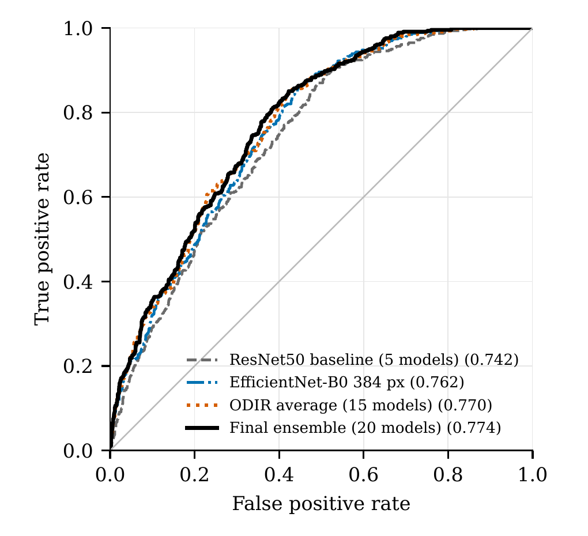
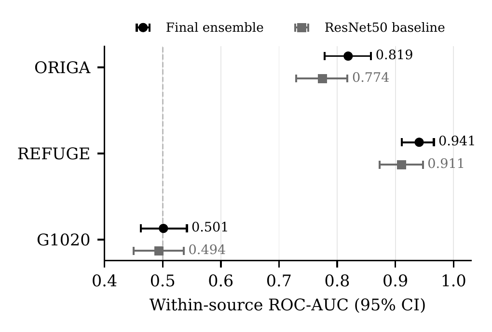

# Transfer Learning for Glaucoma Detection from Fundus Images

**Grouped cross-validation, ODIR pretraining and seed ensembles for ResNet50, DenseNet121 and EfficientNet-B0 on pooled multi-source fundus data.**

> **Research code only. Not a medical device and not for clinical use.**

## Headline results

Final protocol: 10 grouped folds x 5 training seeds, pooled out-of-fold (n = 2,099).

<table>
<tr>
<td align="center"><br><sub>Pooled out-of-fold ROC curves</sub></td>
<td align="center"><br><sub>ROC-AUC by data source</sub></td>
</tr>
</table>

| Model | ROC-AUC (95% bootstrap interval) | PR-AUC |
|---|---|---|
| Final configuration (equal-weight ensemble of 20 EfficientNet-B0 models: ODIR-pretrained at 224 px from 3 pretraining runs, plus ImageNet at 384 px) | **0.774** (0.752 to 0.796) | **0.471** |
| ResNet50 baseline (5 models), same protocol | 0.742 (0.717 to 0.765) | 0.411 |

- Paired difference (final minus baseline): **+0.032** (0.015 to 0.049); the final configuration was higher in **7 of 10** folds.
- During development (5 folds, 3 seeds) every single configuration scored about **0.75 to 0.77**.

**By source (ROC-AUC, final configuration vs ResNet50 baseline):**

| Source | Final | ResNet50 |
|---|---|---|
| ORIGA | 0.819 | 0.774 |
| REFUGE | 0.941 | 0.911 |
| G1020 | 0.501 | 0.494 (chance level) |

Pooled ROC-AUC without G1020: **0.897** vs **0.864**.

Read the [limitations](#limitations) before drawing conclusions: the selection of the final configuration is not blind, the ensembles differ in size, and G1020 is at chance level. The full numbers behind these tables are in [`analysis/final_results_10x5.md`](analysis/final_results_10x5.md) and [`analysis/final_numbers.json`](analysis/final_numbers.json).

## Paper

An associated manuscript is under review. A citation will be added here after publication.

## Authors

- Dhruva R M Upadhyaya (ORCID [0009-0005-1014-7529](https://orcid.org/0009-0005-1014-7529))
- Rijul Bhatia (ORCID [0009-0006-7584-1199](https://orcid.org/0009-0006-7584-1199))
- Deepak Parashar (ORCID [0000-0002-4189-4560](https://orcid.org/0000-0002-4189-4560)), corresponding author
- Soumya Nandan Mishra (ORCID [0000-0002-4115-3498](https://orcid.org/0000-0002-4115-3498))

Contact: please open a GitHub issue.

## Why this problem matters

Glaucoma is a leading cause of irreversible blindness, and early detection matters because lost vision cannot be recovered. Fundus photography is inexpensive, so automated screening is attractive, but models trained on one clinic's data often fail on another's. Reported accuracies in the literature are also easily inflated by near-duplicate images and optimistic splits. This project asks a narrower and more honest question: how well do standard transfer-learning models actually do when the evaluation is strict and spans several sources?

## Data

Three public fundus datasets are used for classification (ORIGA, G1020, REFUGE) and a fourth (ODIR-2019) for optional pretraining. **No data is included in this repository**: no images, labels, split lists, per-image predictions or hashes. Each dataset must be obtained from its original provider (see [What to download](#what-to-download-separately)).

| | Count |
|---|---|
| Usable images (ORIGA, G1020, REFUGE) | 2,468 |
| Development images (used for training and cross-validation) | 2,099 |
| Held-out test images (see below) | 369 |

- **Duplicates:** exact (MD5) and near-duplicate (perceptual hash plus pixel check) images were found. Images of the same eye are placed in one *group* and are never split across folds. One pair of near-identical images carrying conflicting labels was removed. Aggregate counts are in [`results/near_duplicate_summary.csv`](results/near_duplicate_summary.csv).
- **Test split:** 369 images were set aside at the start. The 369-image test split was evaluated twice early in the project, each time on a single ResNet50 model (test ROC-AUC 0.712 for the first baseline, 0.758 for the selected model). No result reported in the final protocol uses it. None of the cross-validation, model selection, ensemble choice or numbers above use it.

## Method

1. **Preprocessing:** CLAHE on the luminance (Y) channel at full resolution (clip limit 2.0, 8x8 tiles), then resize and cache (shorter side 256 px for 224 px crops, 440 px for 384 px crops). Light augmentation (random crop, horizontal flip, small rotation, brightness/contrast jitter).
2. **Models:** ImageNet-pretrained ResNet50, DenseNet121 and EfficientNet-B0 with a new two-class head.
3. **Two-phase training:** Phase A trains only the new head; Phase B fine-tunes the later network stages at a lower learning rate. Class-weighted cross-entropy, learning-rate reduction on plateau and early stopping, with the better phase chosen on an inner validation split only (the held-out fold is scored once).
4. **Optional ODIR pretraining:** EfficientNet-B0 is first trained on glaucoma-vs-normal eyes from the public ODIR dataset (after removing any ODIR image that duplicates a project image, including a hash check against the held-out test images), then used as the starting point for the same two-phase training.
5. **Grouped cross-validation:** stratified (source x class) and grouped by near-duplicate group; the final protocol uses 10 folds x 5 training seeds. Seeds are averaged into an ensemble per configuration.
6. **Statistics:** pooled out-of-fold ROC-AUC and PR-AUC with 95% group-bootstrap intervals (1,000 resamples by group, shared across models so paired differences are valid).

## Limitations

- **Post-hoc selection.** The final configuration was chosen after development scores were known, so the selection is not blind.
- **Unequal ensemble sizes.** The 20-model ensemble is compared with a 5-model baseline, so part of the gain is ensemble size.
- **ODIR benefit is run-dependent.** The benefit of ODIR pretraining depends on the particular pretraining run.
- **G1020 is at chance level**, and we do not know why. Pooled results therefore hide very different behaviour across sources.
- **One fold partition.** Only a single fold partition was used.
- **Test split.** The 369-image test split was opened twice early in the project (see [Data](#data)); it is not used for any comparison reported here.
- **Peer review.** An associated manuscript is under review; the results here have not been peer reviewed.
- Research prototype: no prospective or external clinical validation.

## Repository structure

```
.
├── README.md  CITATION.cff  LICENSE  requirements.txt  .gitignore
├── notebooks/       01-03 development notebooks; 04-05 Kaggle cross-validation notebooks
├── common/          CLAHE + transform module and config used by notebooks 02-03
├── cv_ensemble/     grouped-CV + seed-ensemble pipeline
│   ├── src/         config, data, train, pretrain, odir, aggregate, cv, checks
│   ├── prep_pack.py, hash_target.py, prep_odir.py, pretrain_odir.py, compare_archs.py, test_odir_local.py
├── analysis/        final analysis (analyze_final.py), figure script, final numbers (md, json)
├── results/         small per-run summaries (results.json, run logs, figures), development CV
├── figures/         the two result figures (ROC curves, ROC-AUC by source)
└── docs/            audit and design notes from earlier project phases
```

Each folder has its own short README. Notes in `docs/` document earlier phases (they are not needed to reproduce the final results; the final pipeline uses full images, not disc crops):

- [`docs/notebook4b_audit.md`](docs/notebook4b_audit.md): audit of the class-weight experiments, including the 3-seed replication that measured the run-to-run noise floor of ROC-AUC and PR-AUC on the validation set.
- [`docs/phase0_audit_v2.md`](docs/phase0_audit_v2.md): read-only audit that checked the Version 2 (disc-focused crop) plan against the real data and notebooks before any code was written.
- [`docs/version2_disccrop_design_note.md`](docs/version2_disccrop_design_note.md): design note for building the disc-focused cropped dataset (objective, annotations used, crop rule).
- [`docs/version2_edge_policy.md`](docs/version2_edge_policy.md): pre-registered rule for how disc crops are handled at image edges.

## How to reproduce

### What to download separately

No data is included. The code needs the original datasets from their providers. **Licences and terms of use are set by each provider and are not restated here; check each provider's page before use.**

| Dataset | Used for | Where to get it | Terms |
|---|---|---|---|
| ORIGA(-light) | classification | Described in Zhang et al., IEEE EMBC 2010 (doi [10.1109/IEMBS.2010.5626137](https://doi.org/10.1109/IEMBS.2010.5626137)); the original publication states access is granted on request via the Singapore Eye Research Institute | provider's terms |
| G1020 | classification | Bajwa et al., IJCNN 2020 ([arXiv:2006.09158](https://arxiv.org/abs/2006.09158), doi [10.1109/IJCNN48605.2020.9207664](https://doi.org/10.1109/IJCNN48605.2020.9207664)); follow the dataset link given by the authors | provider's terms |
| REFUGE | classification | [refuge.grand-challenge.org](https://refuge.grand-challenge.org/) (see its download page); Orlando et al., Med. Image Anal. 2020, doi [10.1016/j.media.2019.101570](https://doi.org/10.1016/j.media.2019.101570) | provider's terms |
| ODIR-2019 | optional pretraining | [odir2019.grand-challenge.org](https://odir2019.grand-challenge.org/); the notebooks read the public Kaggle copy `andrewmvd/ocular-disease-recognition-odir5k` | provider's terms (check the Kaggle copy too) |

### Setup

```bash
python -m venv .venv && source .venv/bin/activate
pip install -r requirements.txt
```

The notebooks 01-03 were written for Colab and 04-05 for Kaggle (GPU T4, internet on for the ImageNet weights); `requirements.txt` covers the Python scripts.

### Order of steps

1. **`notebooks/01_environment_dataset_setup.ipynb`**: discovers the images, finds exact and near duplicates, groups same-eye images and creates the fixed split (`split_manifest.csv`, `dataset/`). These outputs are not included.
2. **`notebooks/02_preprocessing_pipeline.ipynb`**: builds the CLAHE and transform pipeline (`common/preprocessing.py`).
3. **`notebooks/03_resnet50_baseline.ipynb`**: the original two-phase ResNet50 baseline recipe. It contains the test-split evaluation cell that was used in the two early evaluations mentioned above; skip that cell unless you want to repeat the early baseline.
4. **`cv_ensemble/prep_pack.py`**: caches the preprocessed development images only (`python cv_ensemble/prep_pack.py` for 256 px; `--resize 440` for 440 px). It reads `results/split_manifest.csv` and `dataset/` from step 1.
5. **`cv_ensemble/hash_target.py`** (only needed for the ODIR arms): fingerprints the project images (MD5 and perceptual hash, plus thumbnails of the test images) so that ODIR images that duplicate a project image can be removed. Its outputs (`target_hashes.csv`, `test_thumbs_128.npz`) refer to the held-out test images and are therefore not included.
6. **`notebooks/04_kaggle_cv_odir_pretraining.ipynb`** (Kaggle): ODIR de-duplication, ODIR pretraining and grouped CV from the pretrained backbone (`PRETRAIN_SEED` 42, then 7). Its markdown cell lists the Kaggle datasets to attach; the code bundle is `cv_ensemble/src` plus `prep_odir.py`, `pretrain_odir.py` and the two files from step 5.
7. **`notebooks/05_kaggle_final_10x5_cv.ipynb`** (Kaggle): the final protocol, one arm per session (`odir42`, `odir7`, `odir123`, `eff384`, `resnet50`). It needs the cached packs from step 4 (as `glaucoma_pack_256.tar` / `glaucoma_pack_440.tar`) and, for `odir42` and `odir7`, the backbones saved by step 6 in a `backbones/` folder of the code bundle.
8. **`analysis/analyze_final.py`**: reproduces the pooled metrics, bootstrap intervals and paired comparisons from the per-fold held-out predictions of the five arms (set `RES_DIR` to the folder with the five unzipped arm folders and `OUT_DIR` for the output); then **`analysis/make_figures.py`** draws the two figures from its `analysis_out/` output. **The per-image predictions are not included because of the dataset licences**, so this step can only be re-run after steps 1-7; the resulting numbers are in `analysis/final_results_10x5.md` and `analysis/final_numbers.json`.

Quick smoke test of the pipeline (about 24 images, 2 folds, 1 seed, 1 epoch), after step 4:

```bash
cd cv_ensemble
python -m src.cv --quick --arch efficientnet_b0
```

## Ethics and intended use

For research and education only. Not a medical device, not validated for clinical use, and not a substitute for examination by an eye-care professional. Models can fail silently on images from sources unlike their training data (as seen on G1020). The datasets are public; this repository redistributes none of their images or labels.

## Datasets and citations

- **ORIGA(-light):** Z. Zhang et al., "ORIGA-light: An online retinal fundus image database for glaucoma analysis and research," IEEE EMBC, 2010.
- **G1020:** M. N. Bajwa et al., "G1020: A benchmark retinal fundus image dataset for computer-aided glaucoma detection," IJCNN, 2020.
- **REFUGE:** J. I. Orlando et al., "REFUGE challenge: A unified framework for evaluating automated methods for glaucoma assessment from fundus photographs," Medical Image Analysis, 2020.
- **ODIR-2019:** Peking University International Competition on Ocular Disease Intelligent Recognition (2019).
- Methods: K. Zuiderveld, "Contrast limited adaptive histogram equalization," Graphics Gems IV, 1994; K. He et al., "Deep residual learning for image recognition," CVPR 2016; J. Deng et al., "ImageNet," CVPR 2009.

To cite this repository, see [`CITATION.cff`](CITATION.cff). A citation for the associated manuscript will be added after publication.

## Licence

Code: MIT (see [`LICENSE`](LICENSE)). The datasets keep their own licences and are not part of this repository.
