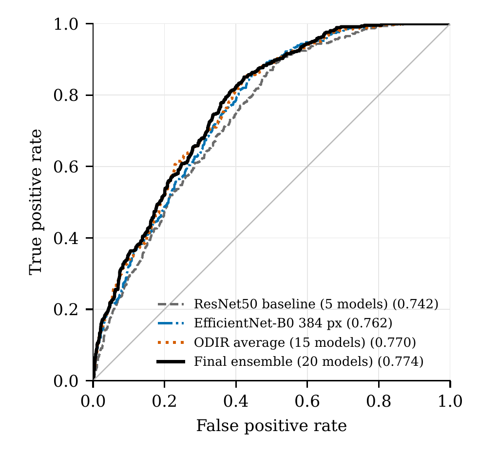
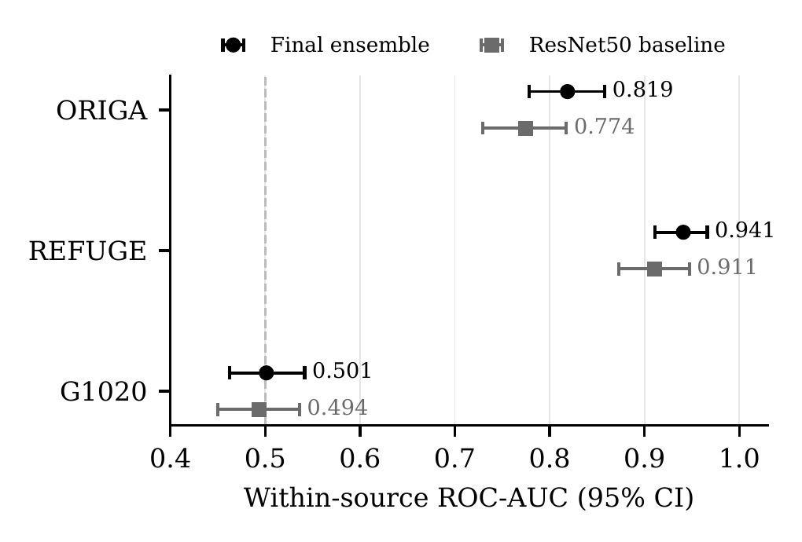

# Transfer Learning for Glaucoma Detection from Fundus Images

**A strict multi-source evaluation: grouped cross-validation, ODIR pretraining and seed ensembles (ResNet50, DenseNet121, EfficientNet-B0).**

> Research code only. This is **not a medical device** and must not be used for clinical decisions. The accompanying paper is an unreviewed draft.

## At a glance (2-minute read)

- **Task:** binary classification (normal vs glaucoma) of colour fundus photographs, pooled from three public sources (ORIGA, G1020, REFUGE).
- **What is different here:** evaluation is deliberately strict. Near-duplicate images of the same eye are grouped so they can never sit in both training and evaluation data; all reported numbers are pooled **out-of-fold** predictions from **10 grouped folds x 5 training seeds**, with **group-bootstrap confidence intervals**.
- **Headline result:** an equal-weight ensemble of 20 EfficientNet-B0 models reaches pooled ROC-AUC **0.774** (95% bootstrap interval 0.752 to 0.796) versus **0.742** (0.717 to 0.765) for a 5-model ResNet50 baseline; paired difference **+0.032** (0.015 to 0.049). Performance differs strongly by source: it is high on REFUGE, moderate on ORIGA and **at chance level on G1020**. See [Limitations](#limitations) before drawing conclusions.
- **Skills shown:** careful experimental design (leakage control, grouped CV, held-out test split, paired bootstrap), PyTorch transfer learning, reproducible pipelines (seeded, resumable, automated PASS/FAIL checks), honest reporting.

## Why this problem matters

Glaucoma is a leading cause of irreversible blindness, and early detection matters because lost vision cannot be recovered. Fundus photography is inexpensive, so automated screening is attractive, but models trained on one clinic's data often fail on another's. Reported accuracies in the literature are also easily inflated by near-duplicate images and optimistic splits. This project asks a narrower and more honest question: how well do standard transfer-learning models actually do when the evaluation is strict and spans several sources?

## Data

Three public fundus datasets are used. **No images or labels from them are included in this repository**; each dataset keeps its own licence and must be obtained from its original source (see [Datasets and citations](#datasets-and-citations)).

| | Count |
|---|---|
| Usable images (ORIGA, G1020, REFUGE) | 2,468 |
| Development images (used for training and cross-validation) | 2,099 |
| Held-out test images (see below) | 369 |

- **Duplicates:** exact (MD5) and near-duplicate (perceptual hash plus pixel check) images were found. Images of the same eye are placed in one *group* and are never split across folds. One pair of near-identical images carrying conflicting labels was removed.
- **Test split:** 369 images were set aside at the start. The 369-image test split was evaluated twice early in the project, each time on a single ResNet50 model (test ROC-AUC 0.712 for the first baseline, 0.758 for the selected model). No result reported in the final protocol uses it. None of the cross-validation, model selection, ensemble choice or numbers below use it.

## Method

1. **Preprocessing:** CLAHE on the luminance (Y) channel at full resolution (clip limit 2.0, 8x8 tiles), then resize and cache (shorter side 256 px for 224 px crops, 440 px for 384 px crops). Light augmentation (random crop, horizontal flip, small rotation, brightness/contrast jitter).
2. **Models:** ImageNet-pretrained ResNet50, DenseNet121 and EfficientNet-B0 with a new two-class head.
3. **Two-phase training:** Phase A trains only the new head; Phase B fine-tunes the later network stages at a lower learning rate. Class-weighted cross-entropy, learning-rate reduction on plateau and early stopping, with the better phase chosen on an inner validation split only (the held-out fold is scored once).
4. **Optional ODIR pretraining:** EfficientNet-B0 is first trained on glaucoma-vs-normal eyes from the public ODIR-5K dataset (after removing any ODIR image that duplicates a project image, including a hash check against the sealed test images), then used as the starting point for the same two-phase training.
5. **Grouped cross-validation:** stratified (source x class) and grouped by near-duplicate group; the final protocol uses 10 folds x 5 training seeds. Seeds are averaged into an ensemble per configuration.
6. **Statistics:** pooled out-of-fold ROC-AUC and PR-AUC with 95% group-bootstrap intervals (1,000 resamples by group, shared across models so paired differences are valid).

**Final configuration:** equal-weight ensemble of 20 EfficientNet-B0 models: ODIR-pretrained models at 224 px from 3 pretraining runs, plus ImageNet-initialised models at 384 px. **Baseline:** 5-model ResNet50 ensemble under the same protocol.

## Results

Final protocol: 10 grouped folds x 5 training seeds, pooled out-of-fold (n = 2,099).

| Model | ROC-AUC (95% bootstrap interval) | PR-AUC |
|---|---|---|
| Final configuration (20-model ensemble) | **0.774** (0.752 to 0.796) | **0.471** |
| ResNet50 baseline (5 models) | 0.742 (0.717 to 0.765) | 0.411 |

- Paired difference (final minus baseline): **+0.032** (0.015 to 0.049); the final configuration was higher in **7 of 10** folds.
- During development (5 folds, 3 seeds) every single configuration scored about **0.75 to 0.77**.

**By source (ROC-AUC, final configuration vs ResNet50 baseline):**

| Source | Final | ResNet50 |
|---|---|---|
| ORIGA | 0.819 | 0.774 |
| REFUGE | 0.941 | 0.911 |
| G1020 | 0.501 | 0.494 (chance level) |

Pooled ROC-AUC without G1020: **0.897** vs **0.864**.

### Key figures

| Pooled ROC curves | ROC-AUC by source |
|---|---|
|  |  |

Per-run summaries (`results.json`, run logs, training figures) for every configuration are in `results/`. Full numbers behind the table: `analysis/final_results_10x5.md` and `analysis/final_numbers.json`.

## Limitations

- **Post-hoc selection.** The final configuration was chosen after development scores were known, so the selection is not blind.
- **Unequal ensemble sizes.** The 20-model ensemble is compared with a 5-model baseline, so part of the gain is ensemble size.
- **ODIR benefit is run-dependent.** The benefit of ODIR pretraining depends on the particular pretraining run.
- **G1020 is at chance level**, and we do not know why. Pooled results therefore hide very different behaviour across sources.
- **One fold partition.** Only a single fold partition was used.
- **Test split.** The 369-image test split was opened twice early in the project (see [Data](#data)); it is not used for any comparison reported here.
- **Draft paper.** The paper is a draft and has not been peer reviewed.
- Research prototype: no prospective or external clinical validation.

## How to reproduce

Datasets are not included, so first obtain ORIGA, G1020 and REFUGE (and ODIR-5K for the pretraining arm) from their original sources. A Kaggle GPU (T4) is sufficient for the cross-validation notebooks (internet on, to download ImageNet weights).

Run in this order:

1. `notebooks/01_environment_dataset_setup.ipynb`: dataset discovery, duplicate grouping and the fixed split.
2. `notebooks/02_preprocessing_pipeline.ipynb`: CLAHE and transform pipeline (`common/preprocessing.py`).
3. `notebooks/03_resnet50_baseline.ipynb`: original two-phase ResNet50 baseline recipe.
4. `cv_ensemble/prep_pack.py`: builds the cached 256 px (and, with `--resize 440`, 440 px) image packs of the development images only.
5. `notebooks/04_kaggle_cv_odir_pretraining.ipynb`: ODIR de-duplication, ODIR pretraining and grouped CV starting from the pretrained backbone (code in `cv_ensemble/`).
6. `notebooks/05_kaggle_final_10x5_cv.ipynb`: the final protocol (10 folds x 5 seeds), one configuration per Kaggle session (`odir42`, `odir7`, `odir123`, `eff384`, `resnet50`).
7. `analysis/analyze_final.py`: reproduces the final numbers and confidence intervals from the saved per-image held-out predictions of the five runs (set `RES_DIR` and `OUT_DIR`). **Those per-image predictions are not included in this repository because of the dataset licences**, so this step can only be re-run after you reproduce steps 1 to 6; `analysis/final_results_10x5.md` and `analysis/final_numbers.json` hold its output. `analysis/make_figures.py` draws the two figures.

The notebooks for Kaggle expect a code bundle (`cv_ensemble/src`, the image pack, and for two arms the saved ODIR backbones) attached as a Kaggle dataset; model weights and image packs are not in this repository.

Quick local smoke test of the pipeline (about 24 images, 2 folds): `python -m src.cv --quick --arch efficientnet_b0` from inside `cv_ensemble/` after building the pack.

## Repository structure

```
.
├── README.md
├── LICENSE                  MIT (code); datasets keep their own licences
├── notebooks/               01-03 development notebooks, 04-05 Kaggle cross-validation notebooks
├── common/                  preprocessing module and config used by notebooks 02-03
├── cv_ensemble/             grouped-CV + ensemble pipeline (src/), pack builder, ODIR scripts, checks
├── analysis/                final analysis script, figure script, final numbers (md/json)
├── results/                 small per-run summaries (results.json, logs, figures), development CV
├── docs/                    selected audit and design notes (disc-crop design, edge policy, audits)
├── figures/                 ROC and per-source figures used in the paper
└── paper/                   LaTeX source (main.tex, body.tex, figures) and compiled draft PDF
```

**Paper / LaTeX:** `main.tex` uses the IEEE JBHI class files (`ieeecolor.cls`, `generic.sty`, logo files), which are **not** included. Download the template from the IEEE JBHI author site to compile it.

## Ethics and intended use

For research and education only. Not a medical device, not validated for clinical use, and not a substitute for examination by an eye-care professional. Models can fail silently on images from sources unlike their training data (as seen on G1020). The datasets are public; this repository redistributes none of their images or labels.

## Datasets and citations

- **ORIGA(-light):** Z. Zhang et al., "ORIGA-light: An online retinal fundus image database for glaucoma analysis and research," IEEE EMBC, 2010.
- **G1020:** M. N. Bajwa et al., "G1020: A benchmark retinal fundus image dataset for computer-aided glaucoma detection," IJCNN, 2020.
- **REFUGE:** J. I. Orlando et al., "REFUGE challenge: A unified framework for evaluating automated methods for glaucoma assessment from fundus photographs," Medical Image Analysis, 2020.
- **ODIR-5K:** Peking University International Competition on Ocular Disease Intelligent Recognition (2019); used via the public Kaggle copy `andrewmvd/ocular-disease-recognition-odir5k`.
- Methods: K. Zuiderveld, "Contrast limited adaptive histogram equalization," Graphics Gems IV, 1994; K. He et al., "Deep residual learning for image recognition," CVPR 2016; J. Deng et al., "ImageNet," CVPR 2009. Full references are in `paper/body.tex` / `paper/main.tex`.

Please follow each dataset's own licence and citation requirements.

## Author and contact

**Dhruv Upadhyaya and Rijul Bhatia**

Contact: _(to be added)_
